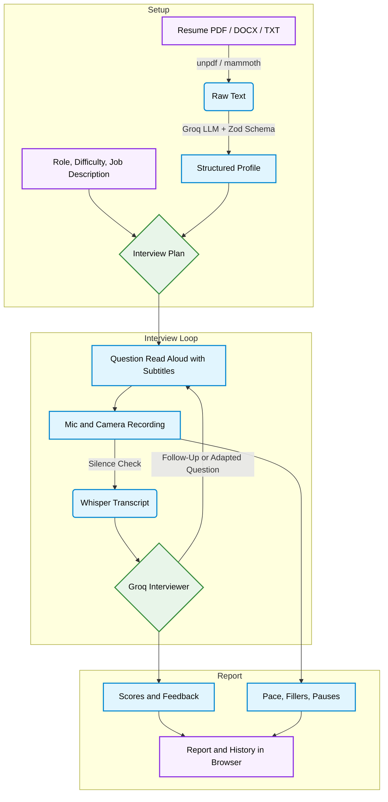

# Hotseat

A spoken mock interview that builds questions from your resume, presses you with follow-ups, and scores every answer. Runs in the browser with your mic and camera.

```
Interviewer: "You led the move from cron jobs to a queue. What failed first?"
You:         "Retries. We hit the same job twice until we added idempotency keys."
Interviewer: "How did you test that the keys actually held under load?"
```

Each question builds on what you just said, and the report scores only what you actually answered.

## Overview

Hotseat is a mock interview you take out loud. Upload a resume, pick a role and difficulty, and an AI interviewer asks questions, listens to your answers and follows up on what you said. At the end you get a scored report with written feedback, a stronger version of each answer, and measured delivery stats such as pace and filler words.

There are no accounts and no database. Sessions live in your browser, and video never leaves your device.

---

### Interview Pipeline



## Features

|                               |                                                                                                       |
| ----------------------------- | ----------------------------------------------------------------------------------------------------- |
| **Resume-Based Questions**    | Upload a PDF, DOCX or TXT, or paste the text. Questions are tied to your own projects and roles       |
| **Role and Job Targeting**    | 22 preset roles or any job title, with seniority, company and an optional job description             |
| **Four Difficulty Levels**    | Easy to Bar Raiser, changing the questions, follow-up depth and time target                           |
| **Interview Formats**         | Behavioural, technical, system design, HR screening or mixed, with three interviewer personas         |
| **Voice Interviewer**         | Questions are read aloud, with subtitles you can turn off                                             |
| **Mic and Camera**            | Device check, self-view, mic and camera toggles, and live captions in Chrome and Edge                 |
| **Adaptive Questions**        | Each question builds on your earlier answers, and new interviews avoid repeating past ones            |
| **Silence Detection**         | Silent recordings are caught before they reach the AI, so it only reacts to what you actually said    |
| **Editable Transcripts**      | Review and correct each transcript before sending, or type your answer instead                        |
| **Code Questions**            | A code box for questions that ask you to write code                                                   |
| **Scored Reports**            | Per-question and competency scores, written feedback and a stronger version of each answer            |
| **Measured Delivery**         | Pace, filler words and pauses, measured from your recordings and kept separate from your score        |
| **Answer Replay**             | Replay each recorded answer next to its feedback                                                      |
| **History and Export**        | Score trend over time, print to PDF, export as JSON, and delete all your data in one click            |
| **Resilient Sessions**        | Reloading resumes the interview, and a failed reply can be retried or passed                          |
| **Bring Your Own Key**        | Visitors can add their own free Groq key in Settings, which skips the site's hourly limit             |

---

## Tech Stack

| Component          | Technology                                                 |
| ------------------ | ---------------------------------------------------------- |
| Framework          | Next.js 16 (App Router), React 19, TypeScript              |
| Interview LLM      | Groq - `openai/gpt-oss-120b` and `openai/gpt-oss-20b`      |
| LLM Fallback       | Gemini (optional), via its OpenAI-compatible API           |
| Speech to Text     | Groq Whisper - `whisper-large-v3-turbo`                    |
| Text to Speech     | Browser Web Speech API                                     |
| Live Captions      | Browser SpeechRecognition API                              |
| Recording          | MediaRecorder and Web Audio API                            |
| Camera Check       | MediaPipe Face Landmarker, running on the device           |
| Resume Parsing     | unpdf and mammoth                                          |
| Schema Validation  | Zod                                                        |
| Storage            | IndexedDB in the browser, via idb-keyval                   |
| Testing            | Vitest and Playwright                                      |
| Hosting            | Vercel                                                     |

---

## Project Structure

```
Hotseat/
├── app/
│   ├── api/              # plan, turn, report, resume, transcribe, health
│   ├── interview/        # The interview room
│   ├── report/[id]/      # Scored report
│   ├── setup/            # Resume, role, format and device check
│   ├── history/          # Past sessions and score trend
│   ├── settings/         # API key, voice, subtitles, privacy
│   └── page.tsx          # Landing page
├── components/           # Top bar, score curve, notices
├── hooks/                # Mic and camera, recording, camera check
├── lib/
│   ├── server/           # LLM providers, prompts, resume parsing, rate limit
│   ├── session.ts        # Interview state machine
│   ├── score.ts          # Report scoring
│   ├── metrics.ts        # Pace, fillers, pauses, silence check
│   ├── speech.ts         # Voice, subtitles and live captions
│   └── storage.ts        # Browser storage
├── tests/
│   ├── unit/             # Vitest
│   └── e2e/              # Playwright, with a fake camera and mic
└── .env.example
```

---

## Setup and Installation

### Prerequisites

- Node.js 20+
- A [Groq API key](https://console.groq.com/keys)

### 1. Clone the repository

```bash
git clone https://github.com/Shashank17singh/Hotseat.git
cd Hotseat
```

### 2. Install dependencies

```bash
npm install
```

### 3. Set your Groq API key

```bash
cp .env.example .env.local
# then edit .env.local and add: GROQ_API_KEY=your_api_key_here
```

To try the interface without a key, set `LLM_PROVIDER=mock` in `.env.local` instead.

### 4. Start the app

```bash
npm run dev
```

Open <http://localhost:3000>, set up an interview and allow mic and camera access.

---

## Running the Tests

```bash
npm test                        # Unit tests
npx playwright install chromium # Once, for the browser tests
npm run build
npm run e2e                     # Browser tests with a fake camera and mic
```

Browser tests run on scripted AI replies, so they need no API key.

---

## Deployment

- **Live URL:** <https://hotseat-black-chi.vercel.app/>

To deploy your own copy for free, import this repository at [vercel.com/new](https://vercel.com/new) and add `GROQ_API_KEY` under Environment Variables. No database is needed. Vercel's HTTPS matters here, because browsers only allow mic and camera access on HTTPS or localhost.

| Variable              | Required | Purpose                                                    |
| --------------------- | -------- | ---------------------------------------------------------- |
| `GROQ_API_KEY`        | Yes      | Runs the interview and speech-to-text                      |
| `GEMINI_API_KEY`      | No       | Chat fallback when Groq is rate limited                    |
| `RATE_LIMIT_PER_HOUR` | No       | Hourly requests per visitor on the shared key. Default 60  |

---

## Known Limitations

- Transcription and scoring are English only.
- The interviewer's voice comes from the browser, so it varies by device and can sound robotic.
- Speech-to-text has no fallback, so voice answers stop if Groq is rate limited. Typing still works.
- History is stored per browser and does not sync between devices. Export reports you want to keep.
- The rate limit is held in memory per server instance, so it slows casual abuse but is not a strict quota.
- The camera-facing figure estimates head direction, not eye contact, and is never scored.
- Vercel's free Hobby plan is for non-commercial use only.

---

## License

MIT. See [LICENSE](LICENSE).
