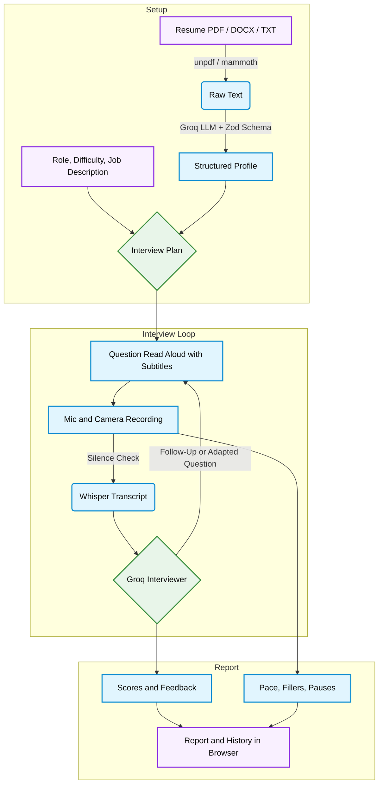
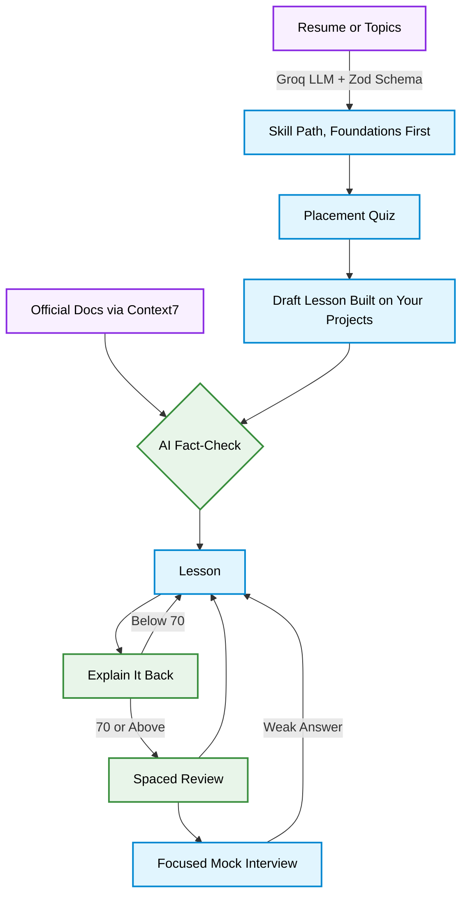

# Hotseat

A spoken mock interview that builds questions from your resume, presses you with follow-ups, and scores every answer. Runs in the browser with your mic and camera.

> **Live Deployments:**
> * **Interactive Web Application (Vercel):** [hotseat-black-chi.vercel.app](https://hotseat-black-chi.vercel.app/)

```
Interviewer: "You led the move from cron jobs to a queue. What failed first?"
You:         "Retries. We hit the same job twice until we added idempotency keys."
Interviewer: "How did you test that the keys actually held under load?"
```

Each question builds on what you just said, and the report scores only what you actually answered.

---

## Overview

Hotseat is a mock interview you take out loud. Upload a resume, pick a role and difficulty, and an AI interviewer asks questions, listens to your answers, and follows up on what you said. At the end you get a scored report with written feedback, a stronger version of each answer, and measured delivery metrics including pace and filler word counts.

The interactive Learn track builds a structured curriculum directly from your resume projects and candidate experience. It assesses prerequisite mastery through a placement quiz, requires active explain-it-back synthesis, and runs automated fact-checks against official library documentation.

Sessions, recordings, and course data live entirely in your browser via IndexedDB—no accounts, no remote databases, and camera streams never leave your device.

---

## Architecture Overview

### Spoken Interview Flow



### Fact-Checked Learning Loop



Lessons are validated against official technical documentation (such as FastAPI, Docker, Kafka, or PostgreSQL) before presentation to prevent misconceptions, and active explain-it-back evaluations prevent passive skimming.

---

## Features

| Feature | Description |
| ------- | ----------- |
| **Resume-Based Targeting** | Ingests PDF, DOCX, or text; questions are tied directly to candidate projects and tech stacks |
| **Customizable Formats** | Behavioural, technical, system design, HR screening, or mixed across 22 preset roles and custom titles |
| **Dynamic Voice Interviewer** | Spoken prompts with toggleable captions, audio recording, and device preview checks |
| **Adaptive Follow-Ups** | Questions dynamically pivot based on prior responses without repeating historical queries |
| **Pre-Flight Silence Detection** | Silent or muted recordings are caught client-side before dispatching to the LLM |
| **Scored Feedback Reports** | Per-question competencies, constructive critique, model responses, and pacing metrics |
| **Spaced Review & Mastery** | Curriculum tracks mastery curves, requiring explain-it-back mastery before unlocking advancement |
| **Zero Server Persistence** | Full client-side isolation using browser IndexedDB storage |

---

## Technology Stack

| Component | Technology |
| --------- | ---------- |
| Web Framework | Next.js 16 (App Router), React 19, TypeScript |
| Inference & Speech | Groq API (`openai/gpt-oss-120b`, `whisper-large-v3-turbo`) |
| Fallback Models | Gemini API (OpenAI-compatible endpoints) |
| Speech & Media APIs | Web Speech API, MediaRecorder, Web Audio API |
| Device AI & Tracking | MediaPipe Face Landmarker |
| Document Extraction | unpdf, mammoth |
| Schema Validation | Zod |
| Client Storage | IndexedDB (`idb-keyval`) |
| Testing | Vitest, Playwright |
| Deployment | Vercel Edge Platform |

---

## Project Structure

```
Hotseat/
├── app/
│   ├── api/              # plan, turn, report, resume, transcribe, health, learn
│   ├── interview/        # Interactive mock interview room
│   ├── learn/            # Course modules, placement quizzes, and lessons
│   ├── report/[id]/      # Evaluation scorecard and delivery metrics
│   ├── setup/            # Resume upload, role selection, and device verification
│   ├── history/          # Historical interviews and progress tracking
│   ├── settings/         # Custom API keys, audio controls, and data deletion
│   └── page.tsx          # Marketing and landing UI
├── components/           # Audio visualizer, score graphs, dialogs, modals
├── hooks/                # Custom React hooks (mic, camera, recording)
├── lib/
│   ├── server/           # LLM clients, system prompts, documentation lookup
│   ├── session.ts        # Interview state machine
│   ├── score.ts          # Competency evaluation algorithms
│   ├── learn.ts          # Skill tree and spaced repetition logic
│   ├── metrics.ts        # Speech pacing, pause frequency, and filler detection
│   ├── speech.ts         # Voice synthesis and captioning
│   └── storage.ts        # IndexedDB abstraction
├── tests/
│   ├── unit/             # Vitest unit test suite
│   └── e2e/              # Playwright browser end-to-end tests
├── package.json
└── README.md
```

---

## Setup and Installation

### Prerequisites

- Node.js 20+
- A [Groq API key](https://console.groq.com/keys)

### 1. Clone the repository

```bash
git clone https://github.com/Shashank17singh/Hotseat.git
cd Hotseat
```

### 2. Install dependencies

```bash
npm install
```

### 3. Configure environment variables

```bash
cp .env.example .env.local
# Edit .env.local and supply your credentials:
# GROQ_API_KEY=your_api_key_here
```

To test the application locally without an active API key, set `LLM_PROVIDER=mock` in `.env.local`.

### 4. Start development server

```bash
npm run dev
```

Open [http://localhost:3000](http://localhost:3000) in your browser.

---

## Running the Tests

Execute unit tests with Vitest:

```bash
npm test
```

Execute end-to-end browser automation tests with Playwright:

```bash
npx playwright install chromium
npm run build
npm run e2e
```

---

## Deployment

The application is optimized for deployment on Vercel:

1. Import the repository on [Vercel](https://vercel.com/new).
2. Configure environment variables in the project settings:
   - `GROQ_API_KEY` (Required for speech-to-text and interviewer inference)
   - `GEMINI_API_KEY` (Optional fallback provider)
   - `RATE_LIMIT_PER_HOUR` (Optional rate limiter threshold, default 60)
3. Deploy. Browser permissions require HTTPS in production environments.

Live production deployment: [hotseat-black-chi.vercel.app](https://hotseat-black-chi.vercel.app/)

---

## Operational Considerations & Limitations

- **Language Scope**: Automated speech recognition and semantic interview evaluation are currently optimized for English-language technical interviews.
- **Browser Speech Synthesis**: Voice synthesis utilizes the host browser's native Web Speech API, with voice timbres dependent on the client operating system and browser engine.
- **Client-Side Edge Inference**: Computer vision and posture analysis execute client-side via WebAssembly and MediaPipe; processing throughput depends on the user device's CPU/GPU acceleration.

---

## License

This project is licensed under the MIT License. See [LICENSE](LICENSE) for details.
